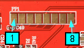
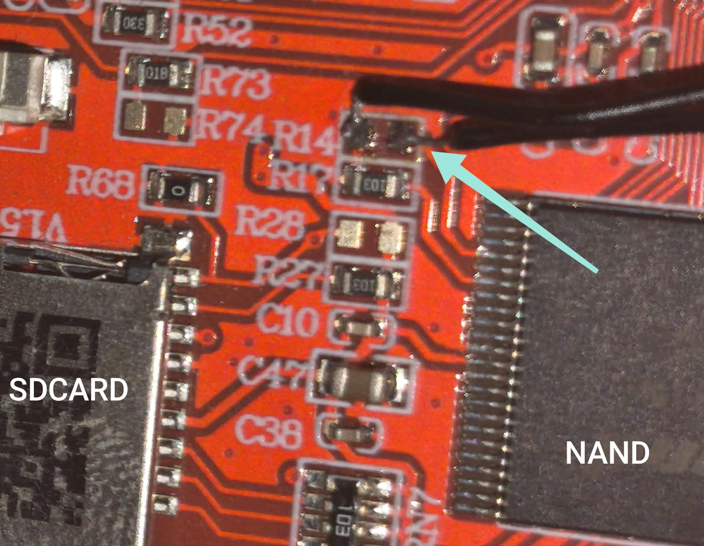

# Flashing the NAND Loader and ferrite-ui on N32903 (Nextion NX8048P070_011)

This guide puts the NAND loader on a blank (or stock) board over JTAG, then uses the loader to write ferrite-ui to NAND.

## Requirements

* Raspberry Pi Pico
* Free-DAP UF2 firmware for the Pico:
  https://github.com/ataradov/free-dap/blob/master/bin/free_dap_rp2040.uf2
* Twisted-pair wires, about 20 cm long (a piece of CAT5/CAT6 cable works well)
* A push button (see [Solder the push button](#solder-the-push-button))
* Nextion NX8048P070_011
* USB-serial converter (3.3 V), to see the loader's messages
* Python 3 with pyserial (`pip install pyserial`)
* From the **files** folder:
  * `openocd_nuvoton.zip`: OpenOCD build with Nuvoton support, plus the `n3290x-freedap.cfg` config
  * `jtag_run_loader.tcl`: OpenOCD script that loads the loader into SDRAM and starts it
  * `n32903_nand_loader.bin`: the loader **without** the IBR header. It is run from SDRAM over JTAG and is used to flash `nandloader.bin`.
  * `nandloader.bin`: the loader **with** the IBR header. This is the copy written to NAND.
  * `flash_tool.py`: host tool for the loader's UART menu
* To build ferrite-ui: the Rust nightly toolchain with `rust-src` and the ARM GNU toolchain (`arm-none-eabi-gcc` on `PATH`). See the N32903 section of `README.md`.

## Setup

### Flash Free-DAP to the Pico

Hold the Pico's BOOTSEL button while plugging it into USB. Copy `free_dap_rp2040.uf2` to the `RPI-RP2` drive that appears. The Pico reboots as a CMSIS-DAP probe.

### JTAG connection to the Pico

The JTAG header is at the top of the NX8048P070_011 board.



Connect the Pico to the board as shown below.

| Pico | Board | Description          |
|------|-------|----------------------|
| GP11 | 6     | TCK                  |
| GP12 | 5     | TMS                  |
| GP13 | 4     | TDI                  |
| GP14 | 3     | TDO                  |
| GP15 | 7     | Reset                |
| GND  | 8     | GND                  |
| -    | 2     | TRST (not connected) |
| -    | 1     | 3.3 V (not connected) |

Use the solid-colored wire of each pair (orange, green, blue, brown) for a signal. Twist the four white-striped wires (orange-white, green-white, blue-white, brown-white) together at both ends and connect them to GND. Each signal then has its own ground return.

The board is powered by its own supply, not by the Pico. Leave pin 1 (3.3 V) unconnected.

### Solder the push button

Solder a push button across the R14 pads, as shown below. Holding it down while the board powers on keeps JTAG usable. A reset disables JTAG on this board, so every JTAG session in this guide starts with this power-on sequence.



### Serial console

Connect the Nextion's TX, RX and GND pins to the USB-serial converter: Nextion TX to converter RX, Nextion RX to converter TX. The console runs at 115200 baud, 8N1.

## Preparing to flash

Extract `openocd_nuvoton.zip` anywhere. All OpenOCD commands below run from its `bin` folder, which already contains `openocd.exe`, `n3290x-freedap.cfg` and `jtag_run_loader.tcl`.

Copy `n32903_nand_loader.bin` from the **files** folder into `bin`. If a file with that name is already there, overwrite it: the copy in the zip is older.

Open a serial monitor on the converter's COM port to see the UART messages. Visual Studio Code's Serial Monitor works well for this.

Press and hold the push button, then power on the Nextion. Wait 1–2 seconds, then release the button.

Open a terminal in the `bin` folder and start OpenOCD:

```powershell
.\openocd.exe -f n3290x-freedap.cfg
```

Open a second terminal and connect to OpenOCD. On Windows, the Telnet Client may first need to be enabled under "Turn Windows features on or off".

```powershell
telnet localhost 4444
```

In the telnet window, send the `halt` command. The output should look like this:

```shell
> halt
target halted in Thumb state due to debug-request, current mode: Supervisor
cpsr: 0xa0000073 pc: 0xffff2146
MMU: disabled, D-Cache: disabled, I-Cache: disabled
```

If the output differs, check the wiring and the Pico, then start again from the beginning.

This step only checks the connection. Close the telnet session, stop OpenOCD (Ctrl+C), and power off the Nextion.

## Flashing the NAND loader

Repeat the power-on sequence: hold the button, power on, release. Then start OpenOCD and connect with telnet as before, but don't send `halt` this time.

The next commands load `n32903_nand_loader.bin` into SDRAM and run it. `run_loader` halts the CPU itself, sets up SDRAM if needed, loads and verifies the image, then starts it. Run the commands one by one in the telnet window:

```shell
source jtag_run_loader.tcl
catch_aborts
run_loader n32903_nand_loader.bin
```

`catch_aborts` is optional. If the loader crashes, it makes the CPU halt at the faulting instruction. Run `abort_info` afterwards to see where.

The Serial Monitor should show messages like these:

```
FA93 Nand Boot Loader entry (20201214).
Warning: RTC not accessible, power-key setup skipped
FA93 chip version: G
System clock=200000KHz  HCLK=100000KHz  SDTIME=0x94E7425
SM ID [EF][F1][0][95][0]
NAND: page=2048  pages/block=64  blocks/flash=1023
Press any key to enter menu : 3
```

Within 3 seconds, send any character from the Serial Monitor to stop the countdown and enter the loader menu. You should see:

```
Type 'help' for commands.
n32903>
```

Close the serial port in the Serial Monitor. Only one program can use the COM port at a time, and `flash_tool.py` needs it next.

Write `nandloader.bin` (the copy with the IBR header) to NAND. The loader writes it to all four boot blocks (0–3) that the chip's boot ROM reads. Replace `COMx` with your COM port:

```
python flash_tool.py COMx writeldr nandloader.bin
```

When it finishes, stop OpenOCD and power-cycle the Nextion without pressing the button. The loader's startup messages should appear on the serial console. It now boots from NAND, so JTAG is no longer needed.

## Flashing ferrite-ui

Build ferrite-ui for the N32903 from the ferrite-ui root folder. This produces `target\arm926ej-s\release\ferrite-ui.bin`.

```powershell
.\n32903.ps1
```

Close the Serial Monitor so the COM port is free, then run the command below. Replace `X:\ferrite-ui` with the path to your ferrite-ui folder.

```
python flash_tool.py COMx writeapp "X:\ferrite-ui\target\arm926ej-s\release\ferrite-ui.bin" --boot
```

`flash_tool.py` stops the loader at its `n32903>` prompt by itself, so you don't need to enter the menu by hand:

* If the menu is already open, it uses it.
* Otherwise, power-cycle the board within 30 seconds of starting the command. You can change the wait with `-w`.

`--boot` starts ferrite-ui once the write is done. Add `-m` to keep printing the serial output afterwards.

## Next: UI resources

The firmware alone has no UI program to run. Build a project and send it, and set up the board, over the same UART:

```powershell
python tools\ferrite_build.py examples\n32903\clock\project.json -o fs.bin
python tools\ferrite_cli.py -p COMx writefs fs.bin
python tools\ferrite_cli.py -p COMx settime      # RTC from the PC clock
python tools\ferrite_cli.py -p COMx calibrate    # touch calibration
```

After every reset, the loader waits 3 seconds for a key. Any byte that arrives in that window (for example a `ping` from `ferrite_cli.py`) stops it at the `n32903>` prompt. Type `boot` there to continue.
