# ferrite-ui

Bare-metal HMI framework written in Rust. Originally built for the Nextion NX8048K070 display (GD32F103 / Cortex-M3); now also runs on Nextion boards built on the Nuvoton N32903 (ARM926EJ-S), the TDO Y13 round display (Allwinner F1C100s) and e-paper displays on ESP32-S3.

The framework is one device-agnostic library (`ferrite-core`); each board is a thin BSP crate under `bsp/`.

For some bricked Nextion displays :)

## Hardware

### Nextion / GD32F103 target

| Component | Part | Details |
|-----------|------|---------|
| CPU | GD32F103RBT6 | Cortex-M3, 108MHz, 128KB Flash, 20KB RAM |
| Display | NX8048K070 | 800x480 TFT LCD |
| Display controller | FPGA | 2MB framebuffer, double-buffered, CPU writes directly |
| Touch | XPT2046 | SPI, Z-pressure detection, median filter |
| Flash | W25Q256JVFQ | 32MB SPI, stores fonts/images/bytecode |
| RTC | AT8563T | I2C |

### Nextion / N32903 target (Rebranded as Ai HMI T8)

| Component | Part | Details |
|-----------|------|---------|
| CPU | Nuvoton N32903 (W55FA93) | ARM926EJ-S, 96MHz, MMU + I/D cache, 8MB SDRAM |
| Display | 800x480 TFT LCD | Parallel RGB from the on-chip VPOST, 16MHz pixel clock |
| Frame buffers | SDRAM | Two RGB565 buffers, vsync flip, alpha blending |
| Touch | On-chip ADC | 4-wire resistive, 3-point calibration stored in config |
| Flash | Winbond NAND (128MB) | 2MB resource region shadowed in SDRAM, BCH ECC, bad-block skipping |
| RTC | AT8563 | Bit-banged I2C on GPB14 (SDA) / GPB13 (SCL) |
| Boot | NAND loader | [n32903_nand_loader_rs](https://github.com/erhanacunal/n32903_nand_loader_rs) loads the app to SDRAM 0x0 |

HAL: [n32903_rs](https://github.com/erhanacunal/n32903_rs) (git submodule `vendor/n32903_rs`).

### TDO Y13 / F1C100s target

| Component | Part | Details |
|-----------|------|---------|
| CPU | Allwinner F1C100s | ARM926EJ-S, 32MB DRAM |
| Display | TL021WVC04 | 480x480 round LCD, DEBE framebuffer, alpha blending |
| Touch | CST8xx | Capacitive, I2C |
| Flash | BY25Q128AS | 16MB SPI NOR (firmware + config + resources) |

HAL: [f1c100s_rs](https://github.com/erhanacunal/f1c100s_rs) (git submodule `vendor/f1c100s_rs`).

The round panel has no reachable corner, so recovery mode on this board is entered by holding the **centre** of the screen at boot. There is no RTC chip: a software clock starts at 2000-01-01 on every boot, set it with `ferrite_cli.py settime`.

| Board | Clock example ([examples/tdo_y13/clock](examples/tdo_y13/clock/)) |
|-------|---------------|
| 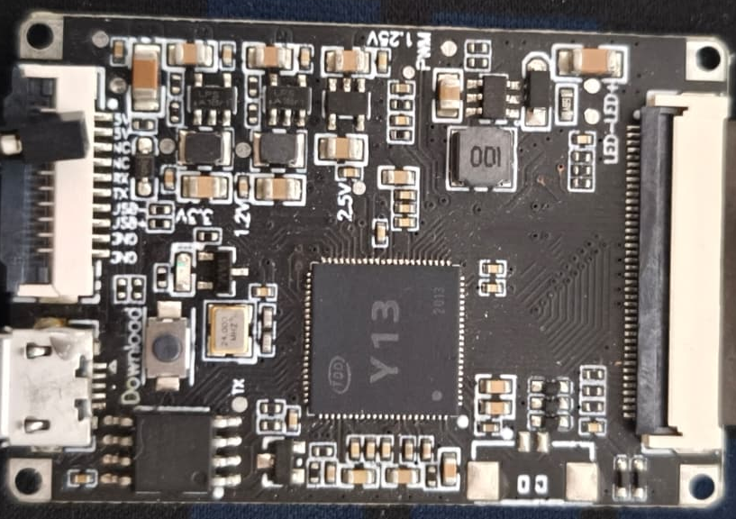 | 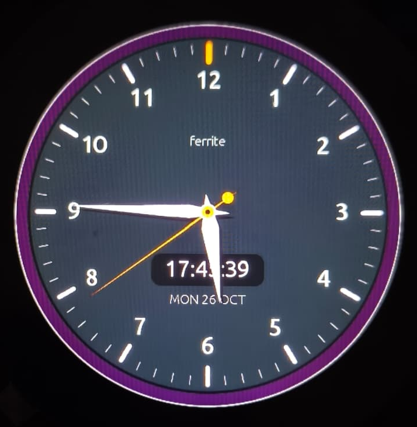 |

### E-paper / ESP32-S3 target

| Component | Part | Details |
|-----------|------|---------|
| CPU | ESP32-S3 | Xtensa LX7, 240MHz, built-in flash |
| Display | ED047TC1 | 960x540 e-paper (4.7", E Ink) |
| Interface | RMT peripheral | Pixel-parallel output via ESP32-S3 RMT |
| Flash filesystem | XIP embedded | `ferrite_fs.bin` linked into binary at build time |

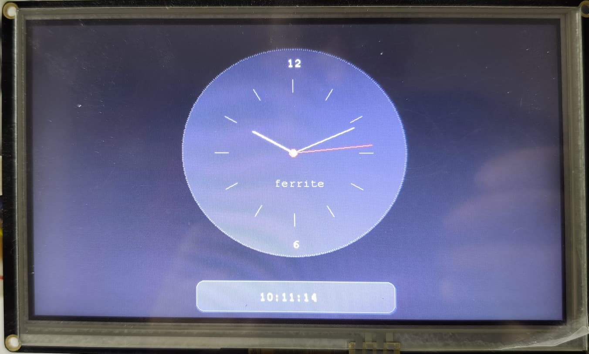

### ST-Link SWD Pinout

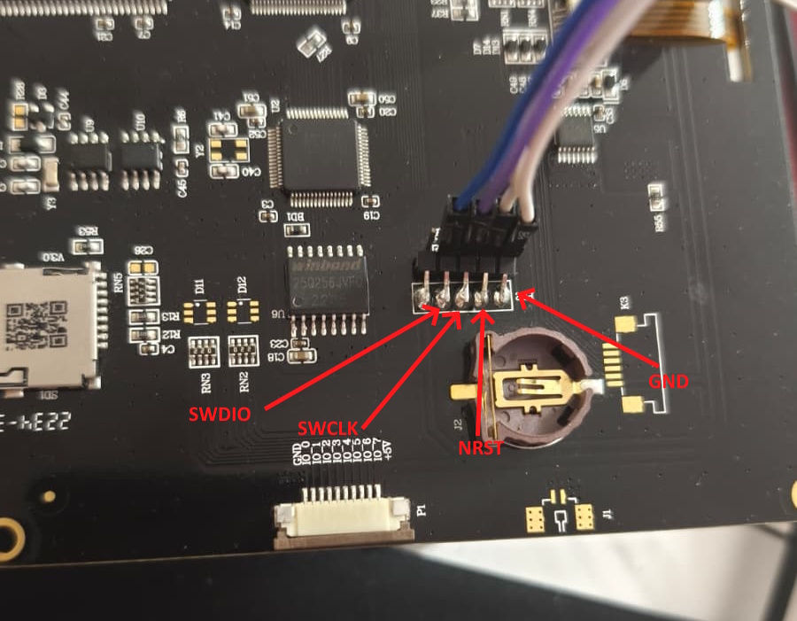

## Features

- **Widget system** -- HTML-like tree structure with CSS box model, split-struct design (20B base + 36B extension on demand)
- **Widget types** -- Base (container), Label, Button, Progress, Slider, Checkbox, Radio, Button Group, Text Input, Gauge, Dropdown, Graph, Image, and shapes (Rectangle, Circle, Polygon, Line, Ellipse)
- **Dirty redraw** -- Two-pass clip-based painter's algorithm (erase hidden, then draw visible)
- **Double buffering** -- FPGA back/front buffer swap, dual-buffer dirty tracking (only changed widgets redrawn per buffer)
- **E-paper render mode** -- Dirty partial-update path with `flush_dirty()` for ED047TC1 panels (no tearing, driven via RMT)
- **Bytecode VM** -- 100+ opcode values, stack-based locals (FRAME prologue), globals, callbacks, arrays, strings, float32, and an 8-deep call stack
- **Drawing primitives** -- fillRect, rect, line, circle, fillCircle, roundedRect, fillRoundedRect, arc, drawImage, drawText
- **Float32 arithmetic** -- Software float (add/sub/mul/div/neg + comparisons + conversion)
- **Float math functions** -- `sin`, `cos`, `sqrt`, `abs`, `atan2`, `floor`, `ceil` (via `libm`, all in radians)
- **`sprintf` builtin** -- printf-style string formatting (`%d`, `%f`, `%x`, `%s`, `%02d`, `%.2f`, …), zero-heap output
- **String pool** -- Heap-allocated strings with auto-incrementing IDs, smart GC preserving widget text
- **Touch input** -- Debounced press/hold/release events, hit testing, on_click and on_tap callbacks, on-screen keyboard
- **Scrollable containers** -- FLAG_CLIP_CHILDREN on any widget, scrollbar, virtual rendering (off-screen children skipped)
- **Custom paint** -- on_paint callback for widget custom drawing
- **Property animation** -- time-based `animate()` tweening of any scalar property (position, size, RGB565 colors, alpha, …) with easing curves, loop/yoyo repeat, and an optional completion callback
- **Flash filesystem** -- TOC-based, named resources (fonts, images, programs, pages, files); XIP-embedded on ESP32
- **Font rendering** -- Adafruit GFX compatible bitmap fonts (flash + embedded)
- **Image format** -- Ferrite Image (FI): raw/RLE/indexed+RLE, streaming decode
- **Recovery mode** -- Hold top-left corner 3s at boot for USART-only reflash mode (see below)
- **USART protocol** -- Protobuf-style serial communication (ping, execute, flash write, user messages)
- **Backlight PWM** -- 0-100% brightness via hardware timer
- **SysTick timer** -- 1ms tick counter, blocking and non-blocking delays
- **Hardware watchdog** -- Auto-reset on hang; fed every main-loop iteration
- **Debug symbols** -- Compiler emits `.dbg` sidecar (variable names, function names) for disassembler and designer

### Recovery Mode

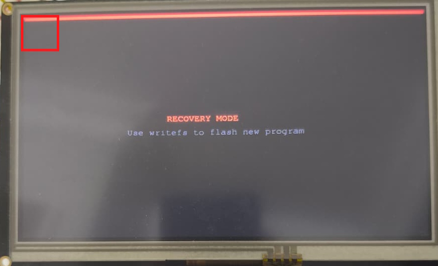

Hold the top-left corner for 3 seconds at boot. A red progress bar fills while holding. Release to cancel. In recovery mode, no program is loaded -- use `writefs` via USART to flash a new program.

### Widget Demo

| Buttons | Sliders |
|---------|---------|
| 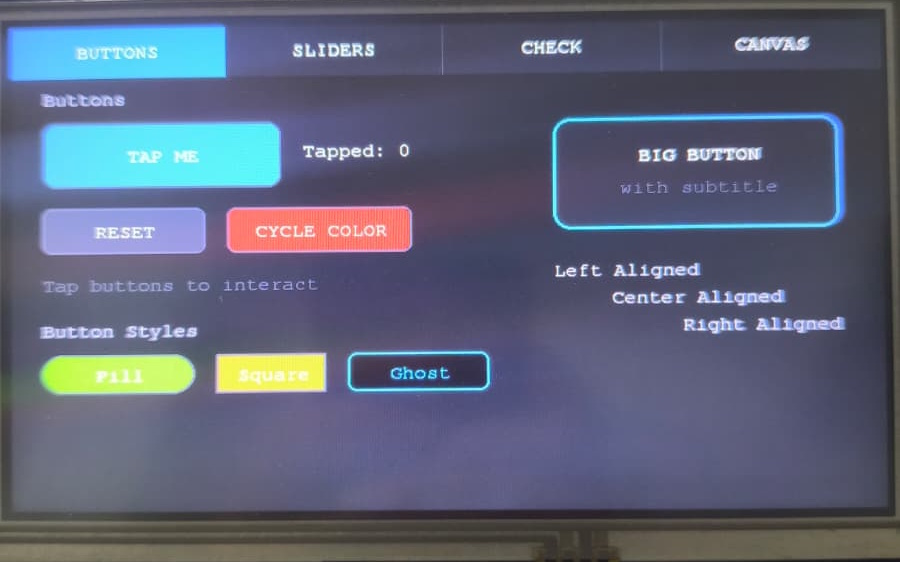 | 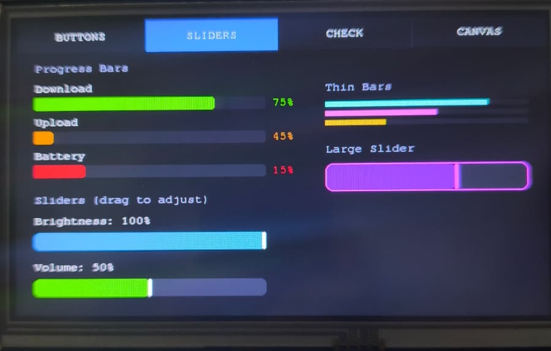 |

| Checkbox / Radio | Canvas (on_paint) |
|------------------|-------------------|
| 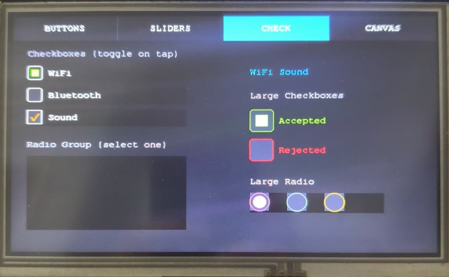 | 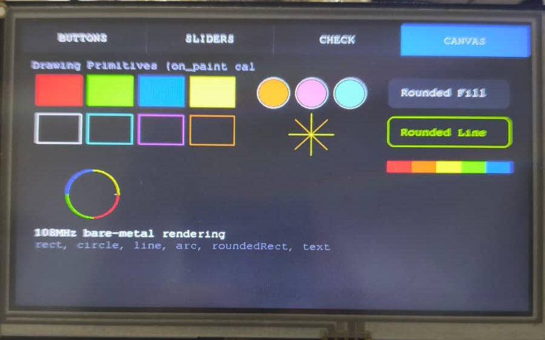 |

| Brick Breaker | Gradient Fill |
|---------------|---------------|
| 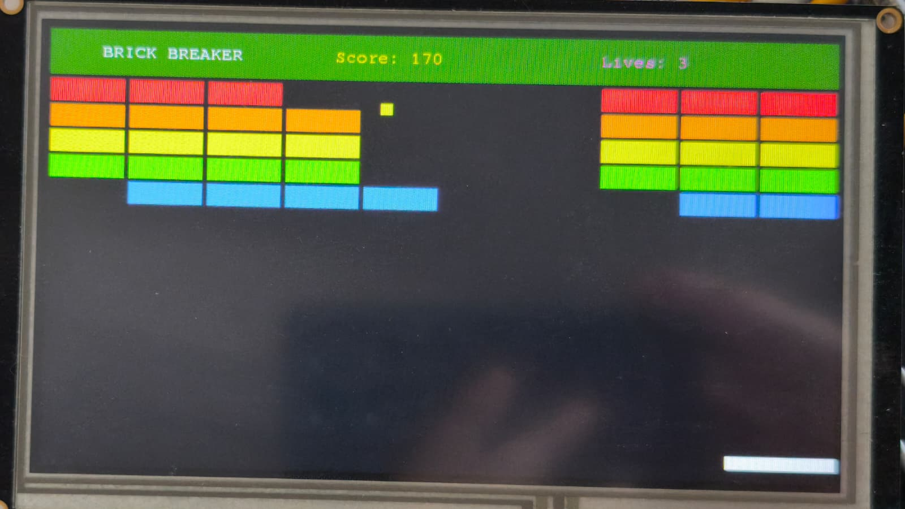 | 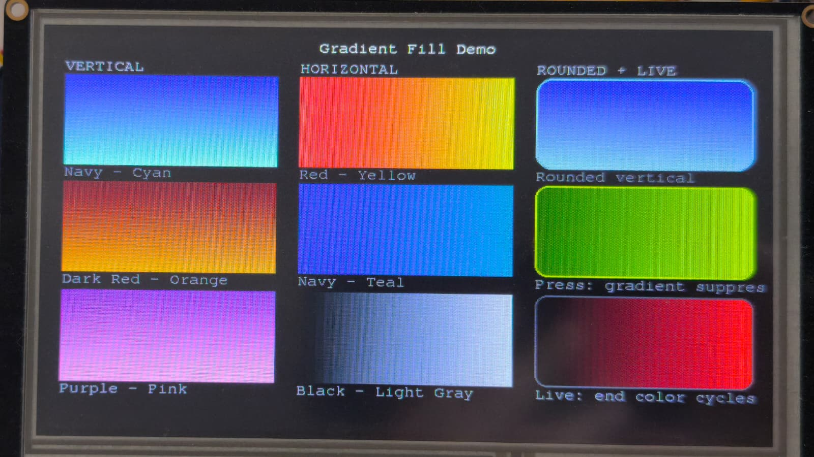 |

### New Components

| Gauge | Scroll List | Text Input + Keyboard |
|-------|-------------|----------------------|
| 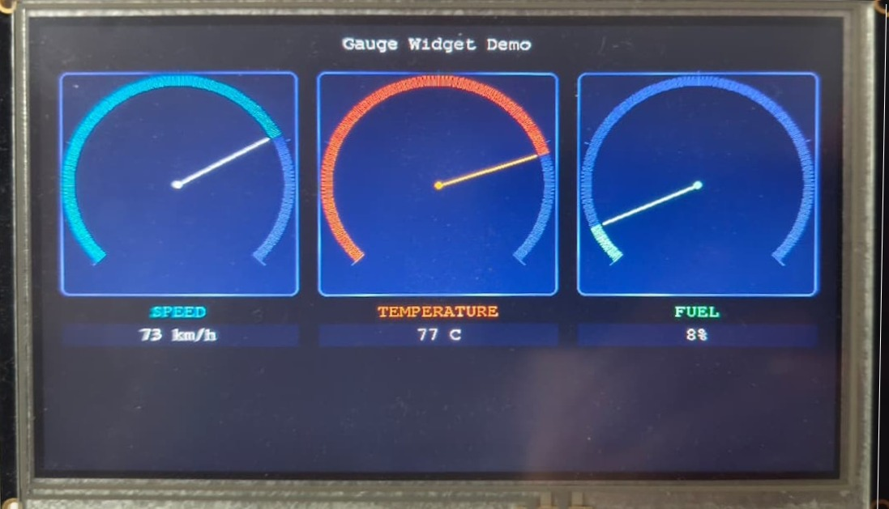 | 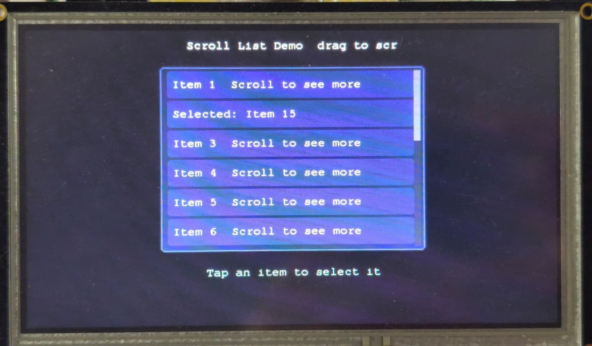 | 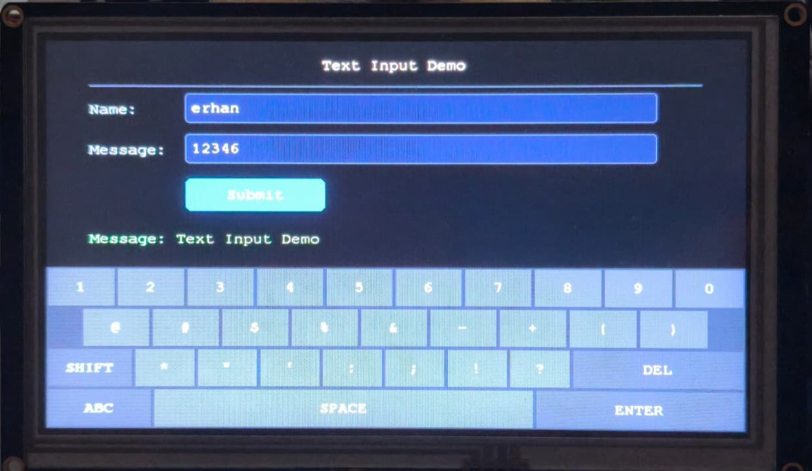 |

### Relay Board

Drives an 8-channel relay board from the user GPIO header ([examples/nextion/relay_board](examples/nextion/relay_board/)). Up to 10 buttons, laid out automatically in two rows of five; each button has a name, an optional image and a group of relays, and switches the group on and off. A relay stays on while any active button includes it. The settings page adds, deletes and edits buttons. OK saves them to the board's EEPROM, so they survive power cycles.

| Main Page | Settings |
|-----------|----------|
| 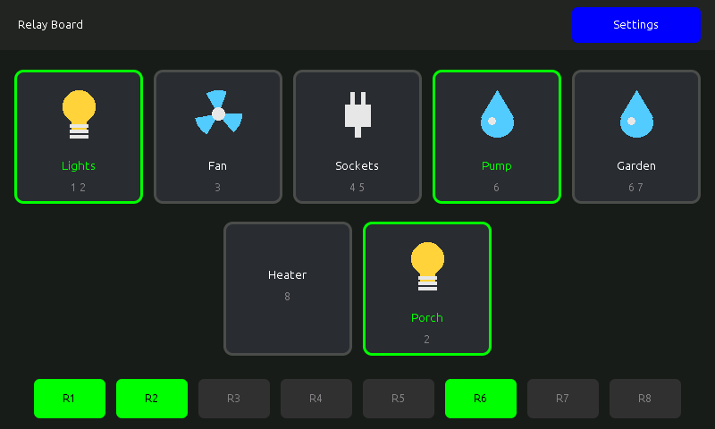 | 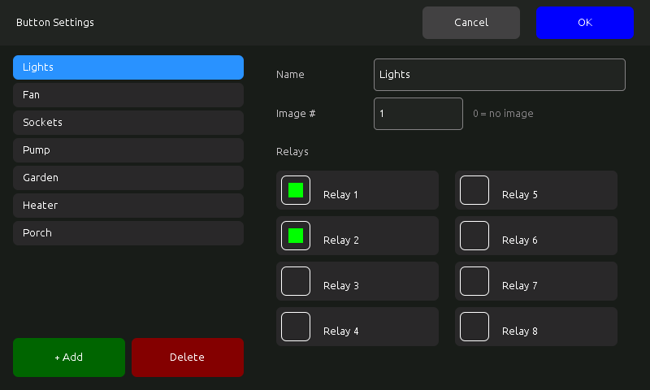 |

### Smart Home Panel

A smart home control panel for the N32903 ([examples/n32903/smart_home](examples/n32903/smart_home/)). Four rooms in the sidebar; the selected room shows a climate dial with its target temperature, a light switch with brightness and the blinds position, and the scene buttons (All off, Morning, Evening, Away) set every room at once. The temperatures are simulated (each room drifts towards its target), and room N's light switches user GPIO pin N. Text uses anti-aliased Ubuntu fonts (2 bpp).

| Living Room | Evening Scene |
|-------------|---------------|
| 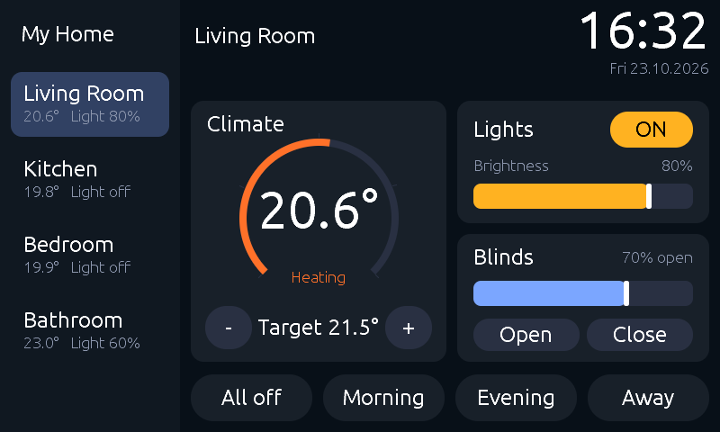 | 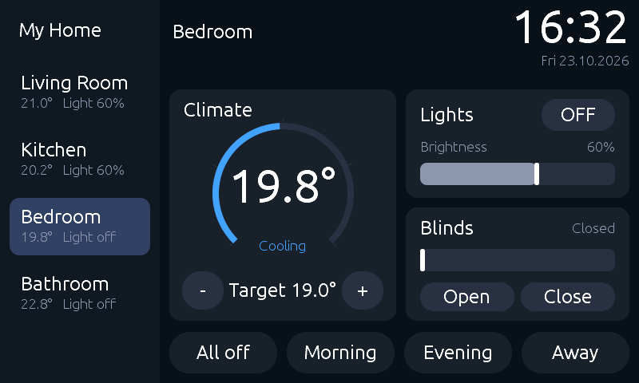 |

Example projects live under [examples/](examples/), including clock, widget demo, touch test, brick breaker, gradient demo, gauge, scroll list, text input, printer menu, dropdown, GPIO, relay board, and smart home panel demos.

## Ferrite Language

Programs are written in a C-like language (`.fl` files) that compiles to VM bytecode. New math functions (`sin`, `cos`, `atan2`, `sqrt`, `abs`, `floor`, `ceil`) and `sprintf` are available as builtins. Here's an [analog clock](examples/clock/standalone.fl) that demonstrates drawing primitives, string operations, and the animation loop:

```c
// Hand positions: 12 entries (R=120), dx = R*sin(i*30°)
var sdx[12] = [0, 60, 104, 120, 104, 60, 0, -60, -104, -120, -104, -60];
var sdy[12] = [-120, -104, -60, 0, 60, 104, 120, 104, 60, 0, -60, -104];

var h = 10;
var m = 10;
var s = 0;

// Clock face
fillCircle(400, 210, 170, 0x2945);
arc(400, 210, 170, 0, 359, 0x4A69);
drawText(392, 68, 0, 0xFFFF, 0, "12");

// Digital time panel
fillRoundedRect(250, 420, 300, 50, 12, 0x2945);
roundedRect(250, 420, 300, 50, 12, 0x4A69);

while (true) {
    // Second hand (red)
    var i = s / 5;
    line(400, 210, 400 + sdx[i], 210 + sdy[i], 0xF800);

    // Center dot
    fillCircle(400, 210, 6, 0xF800);
    fillCircle(400, 210, 3, 0xFFFF);

    // Digital time "HH:MM:SS"
    var ts = concat(itos(h), concat(str(":"),
             concat(itos(m), concat(str(":"), itos(s)))));
    drawStr(345, 450, 0, 0xFFFF, 0, ts);
    strClear();  // free temp strings, widget text preserved

    delay(1000);
    s = s + 1;
    if (s >= 60) { s = 0; m = m + 1; }
    if (m >= 60) { m = 0; h = h + 1; }
    if (h >= 24) { h = 0; }
}
```

See [docs/ferrite-lang.md](docs/ferrite-lang.md) for the full language reference and [examples/](examples/) for complete programs.
See [docs/protocol.md](docs/protocol.md) for the USART protocol reference used by `tools/ferrite_cli.py`.
See [docs/bytecode.md](docs/bytecode.md) for the VM image format, opcode, and widget property reference.

## Designer

`tools/ferrite_designer.py` is a visual layout tool (`pip install PySide6`). It edits a `.fui` project, generates the layout code (`main.designer.fl`), builds the flash image and uploads it over USART.

```sh
python tools/ferrite_designer.py               # new project (asks for the device)
python tools/ferrite_designer.py app.fui       # open a project
```

### Widget palette

The widget toolbar adds one widget per button, in this order. A new widget goes into the selected widget, or into the root if nothing is selected. The **Kind** dropdown in the property panel lists the same widgets.

| Palette | Kind | Notes |
|---------|------|-------|
| Base | 0 | Container. Paints only its `bg_color` and border. |
| Label | 1 | Text with `text_color`, font and alignment. A `bg_color` of 0 is transparent. |
| Button | 2 | Clickable container that shows `press_color` while held. It can hold child widgets, e.g. a label. |
| Progress | 3 | Bar showing `value` 0–100, filled with `press_color`. |
| Slider | 4 | Draggable `value` 0–100. `on_click` receives `(widget_id, value)`. |
| Checkbox | 5 | Toggles `checked` on each tap. |
| Radio | 6 | One `checked` per group. With `group_id` 0 the group is the sibling radios, with any other value it is every radio with that `group_id`. |
| Button Group | 17 | Toggle button: one selected per `group_id`, anywhere in the tree, drawn with `press_color`. Use it for tabs and segmented controls. Set `group_id` before `checked` in code. |
| Dropdown | 9 | Expandable list. Its child widgets are the options, and tapping one copies its text into the dropdown. |
| Image | 11 | Shows an image resource (Resources panel → `image_id`). |
| Rectangle | 12 | Filled with `bg_color`, outlined with `border_color` at the border width. |
| Circle | 13 | Circle inscribed in the widget box, filled and outlined like Rectangle. |
| Polygon | 14 | Points come from `text` as `"x,y x,y …"`, relative to the widget's top-left corner. |
| Line | 15 | Diagonal of the widget box, drawn in `border_color` at the border width. |
| Ellipse | 16 | Ellipse filling the whole widget box. |

Text Input (7), Gauge (8) and Graph (10) are not in the palette yet. Create them in `.fl` code (`lib/core.fl` has the `KIND_*` constants).

The rest of the toolbar deletes the selection, changes its z-order, toggles grid snap, generates code (Ctrl+G), builds the flash image (Ctrl+B) and uploads it to the device on the selected serial port (Ctrl+U).

## Toolchain

```bash
# Compile .fl source to bytecode
python tools/ferrite_lang.py program.fl -o program.bin

# Disassemble bytecode
python tools/ferrite_cc.py disasm program.bin

# Upload and execute on device
python tools/ferrite_cli.py -p COM3 execute program.bin

# Write flash filesystem image
python tools/ferrite_cli.py -p COM3 writefs flash.bin

# Send user message to device
python tools/ferrite_cli.py -p COM3 send 0x01 0x02 0x03

# Convert PNG to Ferrite Image format
python tools/ferrite_img.py icon.png -o icon.fi

# Analyze bytecode memory and instruction profile
python tools/ferrite_analyze.py program.fl -v
```

## Prebuilt Firmware

Each [release](https://github.com/erhanacunal/ferrite-ui/releases/latest) has the GD32 and N32903 firmware, a filesystem image of every example, `ferrite_cli.py` and checksums, built by CI from the release tag. Flashing steps are in the release notes.

## Building

Requires Rust 1.85+ (2024 edition).

### GD32F103 (Nextion / firmware)

```bash
rustup target add thumbv7m-none-eabi

# from the workspace root (the default target is thumbv7m, linked with gd32-link.x)
cargo build -p bsp-nextion --release
arm-none-eabi-objcopy -O binary target/thumbv7m-none-eabi/release/ferrite-ui firmware.bin

# flash to device
st-flash.exe write .\firmware.bin 0x08000000
```

`build.bat` does the build + objcopy in one step.

### N32903 (Nextion, NAND loader)

First time on a board? [N32903_Flashing.md](N32903_Flashing.md) walks through putting the NAND loader on it over JTAG (Raspberry Pi Pico + Free-DAP) and then flashing ferrite-ui. The tools and binaries it uses are in [files/](files/).

Clone with submodules (`git clone --recursive`, or `git submodule update --init`). Needs the nightly toolchain with `rust-src` (pinned by `bsp/n32903/rust-toolchain.toml`) and the ARM GNU toolchain (`arm-none-eabi-gcc`) on `PATH` — it assembles the HAL's startup code and links.

```powershell
# Build -> target\arm926ej-s\release\ferrite-ui.bin (raw image)
.\n32903.ps1

# Write it to NAND with the loader's tool (reset the board when asked)
python flash_tool.py COM10 writeapp target\arm926ej-s\release\ferrite-ui.bin --boot
```

`flash_tool.py` lives in [n32903_nand_loader_rs](https://github.com/erhanacunal/n32903_nand_loader_rs) (a copy is in [files/](files/)); the loader must already be on the board. Resources go over UART1 (115200) like on the other boards:

```powershell
python tools\ferrite_build.py examples\n32903\clock\project.json -o fs.bin
python tools\ferrite_cli.py -p COM10 writefs fs.bin
python tools\ferrite_cli.py -p COM10 settime      # RTC from the PC clock
python tools\ferrite_cli.py -p COM10 calibrate    # touch calibration
```

The loader waits 3 s for a key after reset; any byte arriving then (e.g. a `ping`) stops it at its `n32903>` prompt — type `boot` to continue.

### TDO Y13 (F1C100s)

```powershell
# Build -> bootable sunxi image (objcopy + mksunxi)
.\tdo_y13.ps1
```

Flash the firmware with [xfel](https://xfel.xboot.org) (a copy is in [tools/xfel/](tools/xfel/)) while the F1C100s is in FEL (USB boot) mode:

```powershell
cd tools\xfel
.\xfel.exe spinor write 0 ..\..\target\armv5te-none-eabi\release\ferrite-ui.bin
```

On Windows, xfel needs the WinUSB driver for the FEL device (`VID_1F3A PID_EFE8`) once: run `tools\xfel\Drivers\zadig-2.9.exe`, select the device, choose WinUSB and click *Install/Reinstall Driver*:

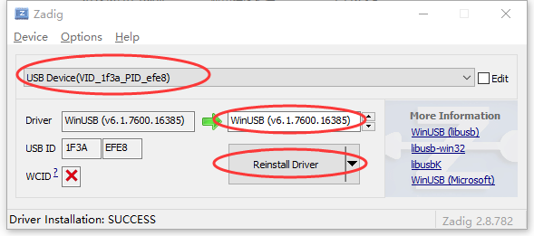

Resources go over UART like on the other boards:

```powershell
python tools\ferrite_build.py examples\tdo_y13\clock\project.json -o fs.bin
python tools\ferrite_cli.py -p COMx writefs fs.bin
python tools\ferrite_cli.py -p COMx settime      # software clock from the PC clock
```

### ESP32-S3 (e-paper)

Use the included `epaper.ps1` script — it sources the ESP toolchain environment, invokes `cargo +esp` with the correct flags, and optionally flashes via `espflash`.

```powershell
# Build only
.\epaper.ps1

# Build and flash (auto-detect port)
.\epaper.ps1 flash

# Build and flash to a specific port
.\epaper.ps1 flash COM3

# Build, flash, and open serial monitor
.\epaper.ps1 monitor
```

**Prerequisites** (one-time setup):

```powershell
# Install espup and the Xtensa Rust toolchain
cargo install espup
espup install          # creates %USERPROFILE%\export-esp.ps1

# Install the flash tool
cargo install espflash
```

`epaper.ps1` automatically sources `%USERPROFILE%\export-esp.ps1` before building. The build script embeds `ferrite_fs.bin` into the binary for XIP-safe flash reads; build the filesystem image first if you have a project ready:

```powershell
python tools/ferrite_build.py examples/epaper_clock/project.json -o ferrite_fs.bin
.\epaper.ps1 flash COM3
```

If `ferrite_fs.bin` is absent a zero-filled placeholder is embedded automatically (the filesystem will report `BadMagic` at runtime until a real image is provided).

### Host Simulator

Use the root `sim.bat` helper to build an example's flash image and launch the host simulator from the command line:

```bash
sim.bat examples\dropdown
sim.bat examples\widget_demo
```

The repository default target is embedded, so pass a host target if you run the simulator manually:

```bash
python tools\ferrite_build.py examples\dropdown\project.json -o examples\dropdown\flash.bin
cargo run --target x86_64-pc-windows-msvc --features host --bin sim -- --fsimage examples\dropdown\flash.bin
```

## Resource Notes

Exact firmware size changes as features are added; inspect the current build artifacts instead of relying on fixed README numbers.

| | Nextion GD32F103 | Nextion N32903 | TDO Y13 (F1C100s) |
|---|---|---|---|
| Code | 128 KB MCU flash | ~150 KB image in SDRAM | in DRAM, loaded from SPI NOR |
| RAM | 20 KB | 8 MB SDRAM | 32 MB DRAM |
| Heap | 14 KB (ferrite-core allocator) | ~3 MB free after frame buffers + NAND shadow (HAL allocator) | rest of DRAM (HAL allocator) |
| Frame buffer | none in CPU RAM (FPGA) | 2 × 800×480 RGB565 in SDRAM | 3 × 480×480 ARGB8888 in DRAM |
| String pool | 2 KB / 64 strings | 1 MB / 256 strings | 1 MB / 256 strings |
| Resource storage | 32 MB SPI NOR | 2 MB NAND region, shadowed in SDRAM | SPI NOR after the firmware |
| USART RX ring | 128 B | 4 KB | 4 KB |

Common: clip region pool 32 rects (256 B). Heap-allocated: Ctx (object pool for widgets, strings and arrays; FontList, ImageList), VM (stack-based locals, callback queue), fonts.

## Project Structure

Cargo virtual workspace: one framework library, one BSP crate per board.

```
ferrite-ui/
├── ferrite-core/        Framework library (crate `ferrite_core`), generic over `P: Platform`
│   └── src/
│       ├── runtime.rs   Main loop (`run::<P>()`), PlatformRuntime hooks, input handling
│       ├── platform.rs  Platform trait (backend types, flash layout, caps)
│       ├── ctx.rs       Shared application context (Ctx<P>)
│       ├── vm.rs        Bytecode VM (stack frames, callbacks, arrays, f32, math, animation)
│       ├── pool.rs      Object pool: one compacting arena for widgets, strings, arrays
│       ├── widget.rs    Widgets (header + optional sections), tree, box model
│       ├── render.rs    Painter's algorithm, dirty redraw, clip
│       ├── clip.rs      Clip region (rect subtract algorithm)
│       ├── font.rs      Sparse UTF-8 bitmap font renderer (+ embedded_font.rs)
│       ├── image.rs     Ferrite Image (FI) decoder
│       ├── fs.rs        Flash filesystem (TOC, named resources)
│       ├── config.rs    Persistent config sector (touch calibration, ...)
│       ├── strpool.rs   Strings on the object pool (itos/ftos/concat/sprintf/sweep)
│       ├── protocol.rs  USART protobuf protocol (+ proto.rs primitives)
│       ├── keyboard.rs  On-screen keyboard for input widgets
│       └── {lcd,flash,touch,usart,backlight,rtc,systick,sdcard,audio}.rs
│                        Backend traits + generic wrappers
├── bsp/
│   ├── nextion/         GD32F103 + FPGA LCD (Cortex-M3)
│   ├── n32903/          Nuvoton N32903 + VPOST LCD + NAND (ARM926EJ-S)
│   ├── tdo_y13/         Allwinner F1C100s + 480x480 round LCD (ARM926EJ-S)
│   ├── epaper/          ESP32-S3 + ED047TC1 e-paper
│   └── sim/             Host simulator (minifb)
├── vendor/              HAL submodules (f1c100s_rs, n32903_rs)
├── tools/
│   ├── ferrite_lang.py  Language compiler (.fl -> bytecode + .dbg symbols)
│   ├── ferrite_cc.py    Assembler / disassembler / compiler API
│   ├── ferrite_build.py JSON project builder (flash image)
│   ├── ferrite_cli.py   Serial communication tool (writefs, settime, calibrate, ...)
│   ├── ferrite_img.py   PNG to Ferrite Image converter
│   ├── ferrite_analyze.py  Bytecode memory/instruction profiler
│   ├── ferrite_designer.py Visual designer (multi-device)
│   └── devices/         Per-board specs (screen, fs_base, caps) for the tools
├── lib/                 Ferrite language libraries (core, color, anim, shapes, touch, ...)
├── examples/            Ferrite projects per board (nextion/, n32903/, tdo_y13/, lilygo-t5/)
├── docs/                Language, protocol and bytecode references
├── files/               N32903 flashing kit: OpenOCD, JTAG script, NAND loader, flash_tool.py
├── n32903.ps1, tdo_y13.ps1, epaper.ps1   Board build scripts
├── gd32-{link,memory,device}.x  GD32F103 linker scripts (bsp/nextion)
└── CLAUDE.md            Internal development notes
```

## Architecture

- **One framework, thin BSPs** -- `ferrite-core` is generic over a `Platform` trait (LCD, flash, touch, USART, backlight, RTC, systick, SD, audio backends); each board crate supplies the backends, entry point and panic handler and calls `ferrite_core::runtime::run::<P>()`
- **Heap allocation** -- all large structures are heap-allocated via Box/Vec: a 14KB linked-list allocator on the GD32, the HAL's interrupt-safe allocator on the ARM926 boards (`external_alloc`)
- **No OS, no std firmware** -- `#![no_std]`, `#![no_main]`; `cortex-m-rt` (GD32), `esp-hal` (ESP32-S3), HAL startup code + MMU/cache setup (N32903, F1C100s)
- **Frame buffer per board** -- none in CPU RAM on the GD32 (pixels go straight to the FPGA over a 16-bit GPIO bus); SDRAM/DRAM frame buffers scanned out by the display controller on N32903 (VPOST) and F1C100s (DEBE), which also enables alpha blending; RMT-driven framebuffer on the ESP32-S3 e-paper
- **Double buffered** -- front/back swap by the FPGA (GD32) or at vsync by the display controller (N32903, F1C100s), tear-free rendering
- **Flash abstraction** -- NOR-style API (byte read, page program, 4KB sector erase); the N32903 maps it onto NAND through an SDRAM shadow with deferred block write-back
- **Three render modes** -- `dirty` (partial update, front buffer), `buffered` (full double-buffered redraw), `epaper` (dirty + `flush_dirty()` to e-paper panel)
- **Two-pass dirty redraw** -- erase hidden widgets first, then draw visible ones with clip-based painter's algorithm
- **Split-struct widgets** -- 20B base (tree links, layout, colors) + 36B extension on demand (edges, text, callbacks, render bookkeeping)
- **Stack-based VM locals** -- FRAME prologue per function, locals isolated across CALL/RET, supports recursion
- **Math builtins via libm** -- sin/cos/sqrt/abs/atan2/floor/ceil compiled to single opcodes, no interpreter overhead
- **sprintf zero-heap** -- format output written to a 128B stack buffer, then interned into the string pool as one allocation
- **Debug symbols sidecar** -- compiler writes `.dbg` alongside bytecode; disassembler and designer use it for human-readable names
- **Shared context** -- Ctx struct bundles LCD, Flash, ObjPool, FontList, ImageList, Fs

## License

MIT License. See [LICENSE](LICENSE) for details. Third-party code and its licenses are listed in [THIRD_PARTY_NOTICES.md](THIRD_PARTY_NOTICES.md).

This project is an independent, clean-room implementation. It is not affiliated with or endorsed by ITEAD (Nextion).
